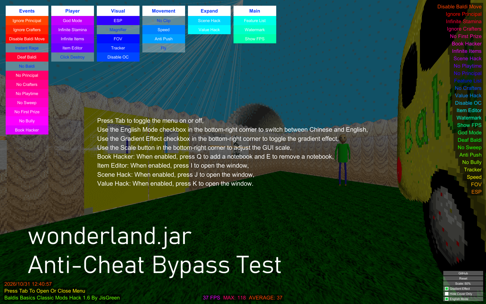
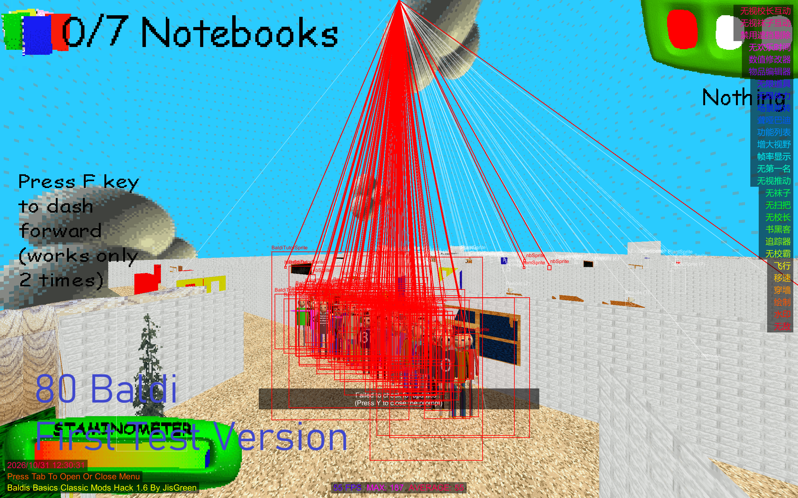

# Baldi's Basics Classic Mods Hack 1.6

基于 __BepInEx 5.4.23__，为 __Baldi's Basics Classic Template__ 和 __Baldi's Basics Classic Remastered Template__ 的__模组版本__创建的__通用作弊菜单__。

Based on __BepInEx 5.4.23__, a __universal cheat menu__ created for __mod versions__ of __Baldi's Basics Classic Template__ and __Baldi's Basics Classic Remastered Template__.

__我不保证全部功能都能正常在所有版本正常运行！但是我们仍然是中文社区公认适配能力最强的跨模组插件。__ 

__I do not guarantee that all features will work properly on all versions! But we are still the cross-mod plugin with the strongest compatibility recognized by the Chinese community.__

---

## 功能列表

### 事件类
| 功能 | 说明 |
|------|------|
| 无视校长互动 | Principal 无法抓住你。 |
| 无视袜子互动 | Arts and Crafters 无法传送。 |
| 禁用巴迪移动 | Baldi 完全停止移动。 |
| 直接激活愤怒 | 立即让 Baldi 进入愤怒状态。 |
| 聋哑巴迪 | Baldi 永久失去听力，无法响应声音。 |
| 无巴迪 | 隐藏 Baldi。 |
| 无校长 | 隐藏 Principal。 |
| 无袜子 | 隐藏 Arts and Crafters。 |
| 无欢乐时间 | 隐藏 Playtime。 |
| 无扫把 | 隐藏 Gotta Sweep。 |
| 无第一名 | 隐藏 1st Prize。 |
| 无校霸 | 隐藏 Bully。 |
| 书黑客 | Q 键增加笔记本，E 键减少笔记本。 |

### 移动类
| 功能 | 说明 |
|------|------|
| 穿墙 | 关闭碰撞检测。 |
| 移速 | 二倍移动速度。 |
| 无视推动 | 免疫 Gotta Sweep 和 1st Prize 的推动。 |
| 飞行 | R 键向上，F 键向下，建议搭配 穿墙 使用。 |

### 玩家类
| 功能 | 说明 |
|------|------|
| 无敌 | 无视 Baldi 击杀以及 Playtime 互动。|
| 无限体力 | 体力永不消耗。 |
| 无限道具 | 使用道具不消耗。 |
| 道具编辑器 | 使用 I 键打开面板。 |
| 点击破坏 | 左键破坏前方的 Mesh 控件。 |

### 视觉类
| 功能 | 说明 |
|------|------|
| 绘制 | 方框透视所有 Sprite，显示名称。 |
| 放大镜 | 缩小视野，类似望远镜效果。 |
| 增大视野 | 增大视野范围。与放大镜同时开启则恢复默认。 |
| 追踪器 | 从每个 Sprite 方框顶部连线到屏幕顶部中心。 |
| 禁用遮挡剔除 | 禁用遮挡剔除，但这可能影响游戏性能。 |

### 扩展类
| 功能 | 说明 |
|------|------|
| 场景跳转 | 使用 J 键打开面板。 |
| 数值修改器 | 使用 K 键打开面板。 |

### 主菜单
| 功能 | 说明 |
|------|------|
| 功能列表 | 屏幕右上角显示已开启的功能，同时拥有美观的RGB渐变。 |
| 水印 | 屏幕左下角显示文字，同时拥有美观的RGB渐变。 |
| 帧率显示 | 屏幕屏幕下显示帧率信息，同时拥有美观的RGB渐变。 |

---

## 安装方法

1. 下载 [`BepInEx 5.4.2`](https://github.com/BepInEx/BepInEx/releases)。
2. 将 `BepInEx` 解压到游戏根目录。
3. 打开 `BepInEx` 文件夹并创建 `plugins` 文件夹。
4. 下载 `BaldisBasicsClassicModsHack.dll`。
5. 将 `BaldisBasicsClassicModsHack.dll` 放入 `BepInEx/plugins/` 文件夹。
6. 启动游戏，按 `Tab` 关闭或开启菜单。

---

## 如何保护

模组开发者可以使用 il2cpp 构建以阻止框架加载，或对代码进行混淆。

---

## 免责声明

本工具仅供学习交流使用，禁止用于任何非法用途，出现任何责任，都与作者及 MuaHax Team 无关。

---

## 开源协议

MIT协议。

---

**Baldis Basics Classic Mods Hack By JisGreen**
